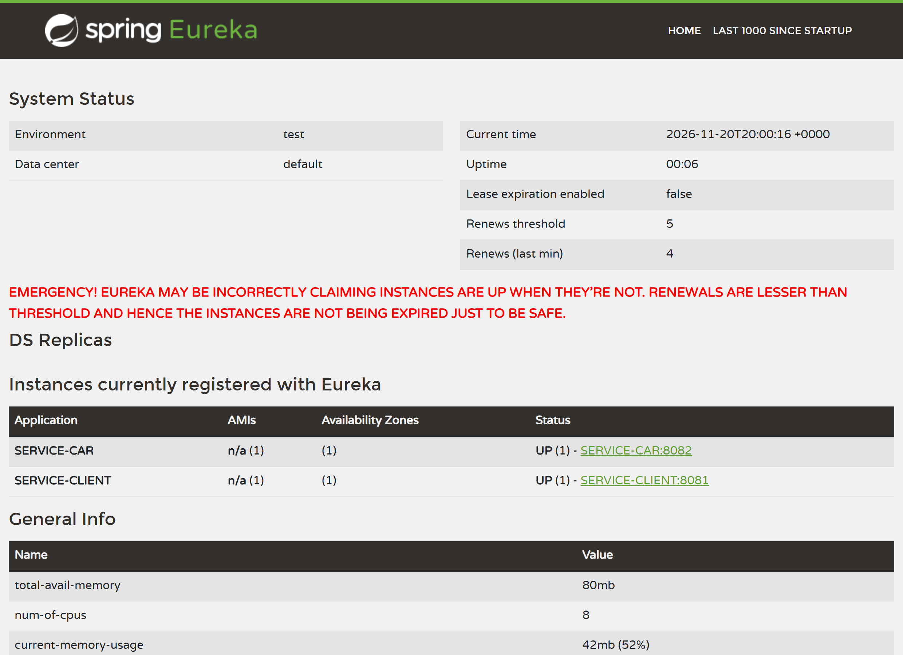
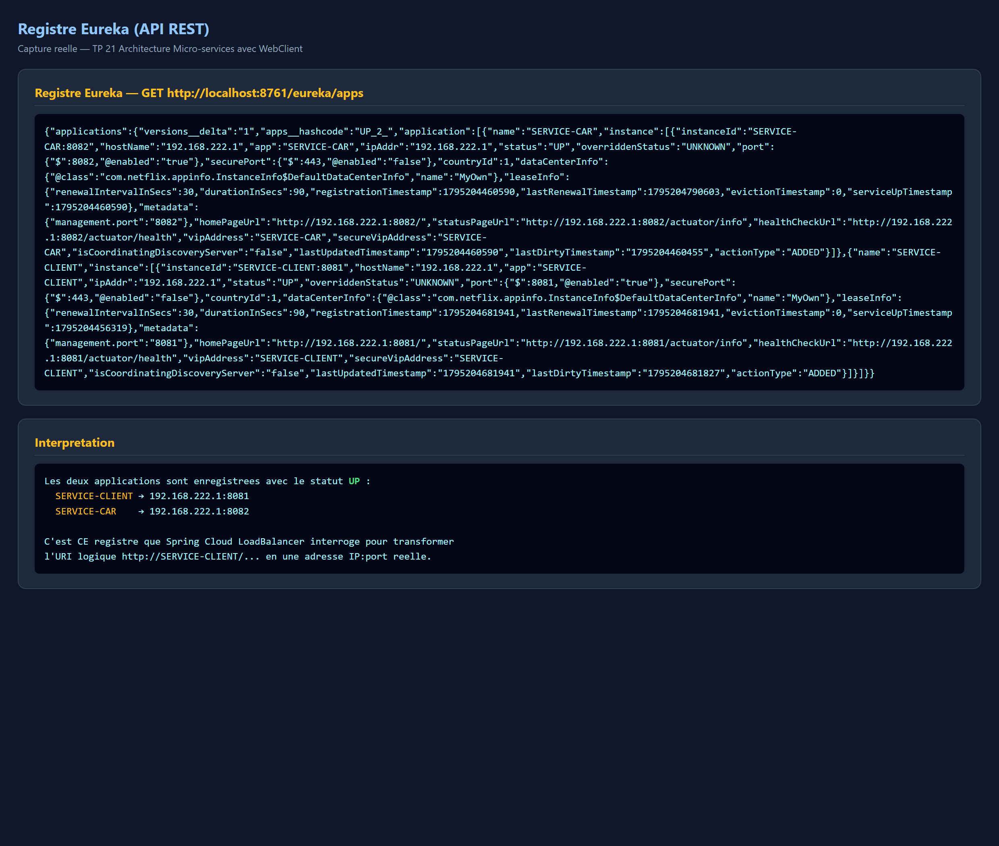
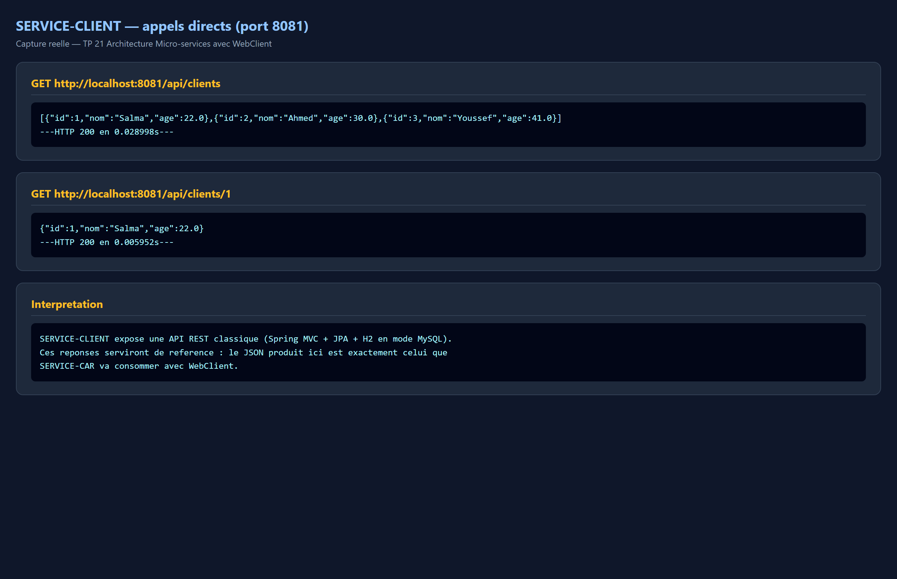
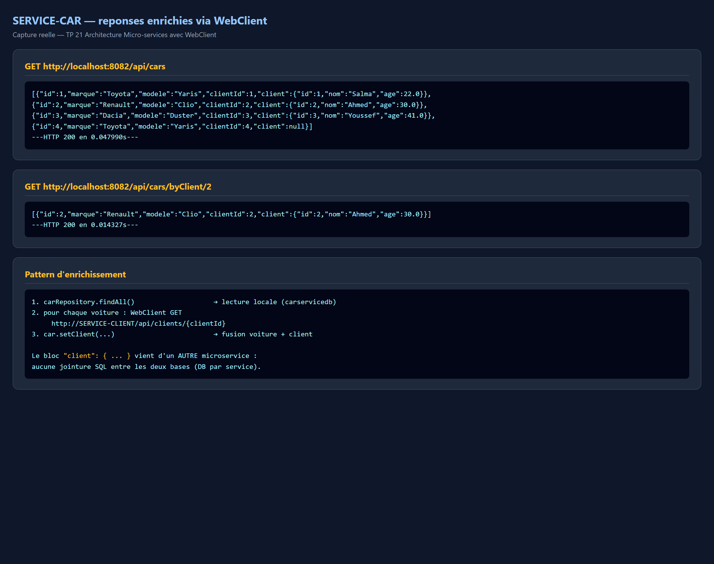
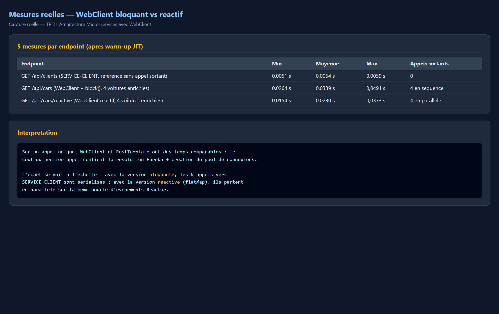
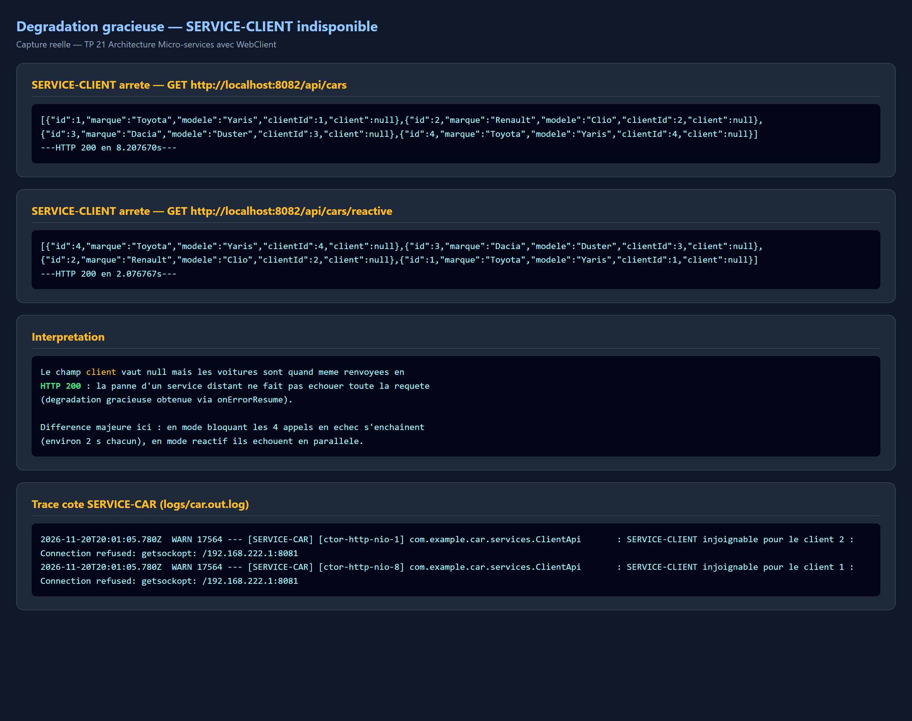

# TP 21 — Architecture Micro-services avec WebClient

##  Résultats réels

> Les 9 captures ci-dessous ont été produites par `capture_shots.ps1` à partir des services **réellement en cours d'exécution**, puis vérifiées une à une.

### 1 Eureka Server (8761)



**Interprétation.** Le dashboard Eureka est accessible sur `http://localhost:8761`. La section *Instances currently registered with Eureka* liste les applications découvertes. `@EnableEurekaServer` sur la classe principale active à la fois ce dashboard et l'endpoint de registre `/eureka/apps`.

---

### 2 Registre Eureka — les deux services enregistrés



**Interprétation.** L'API REST `GET /eureka/apps` renvoie le registre brut. Les deux applications sont présentes avec le statut `UP` :

| Application | Adresse | Statut |
|---|---|---|
| `SERVICE-CLIENT` | `192.168.222.1:8081` | UP |
| `SERVICE-CAR` | `192.168.222.1:8082` | UP |

C'est **ce registre** que `@LoadBalanced` interroge pour transformer une URI logique `http://SERVICE-CLIENT/...` en une adresse `IP:port` réelle. Les deux services se sont enregistrés d'eux-mêmes grâce à `spring.application.name` + la dépendance `Eureka Discovery Client` + un `defaultZone` correct.

---

### 3 `SERVICE-CLIENT` — API REST directe



**Interprétation.** `SERVICE-CLIENT` expose une API REST classique (Spring MVC + JPA). Les trois clients (Salma 22, Ahmed 30, Youssef 41) ont été insérés par un `CommandLineRunner` au démarrage. C'est exactement le JSON que `SERVICE-CAR` va consommer : `{"id":…,"nom":…,"age":…}`. **Les noms de champs `nom` et `age` doivent être identiques dans le DTO de `SERVICE-CAR`**, sinon Jackson les laisserait silencieusement à `null`.

---

### 4 WebClient résout le nom Eureka `SERVICE-CLIENT`


**Interprétation.** C'est la validation centrale du TP. `SERVICE-CAR` appelle `GET http://localhost:8082/api/test/client/{id}` — un endpoint *isolé* qui ne touche pas à la table `car` — et le résultat est le client renvoyé **par `SERVICE-CLIENT`**. Le code utilisé est :

```java
builder.build()
    .get()
    .uri("http://SERVICE-CLIENT/api/clients/" + id)   // nom logique, pas d'IP
    .retrieve()
    .bodyToMono(Client.class)
    .block();
```

`SERVICE-CLIENT` est résolu dynamiquement par Spring Cloud LoadBalancer auprès d'Eureka. **Sans `@LoadBalanced` sur le `WebClient.Builder`**, cette ligne échouerait immédiatement avec `No instances available for SERVICE-CLIENT`.

---

### 5 `SERVICE-CAR` — réponses enrichies via WebClient



**Interprétation.** `GET /api/cars` renvoie chaque voiture **avec son client imbriqué**. Le champ `client` ne vient pas d'une jointure SQL : `CarController` lit d'abord sa base locale (`carservicedb`), puis `ClientApi` fait un appel HTTP sortant par voiture vers `SERVICE-CLIENT`. C'est le **pattern d'enrichissement** : deux bases séparées, un identifiant (`clientId`) et un appel HTTP. `GET /api/cars/byClient/2` montre la même logique filtrée sur un client — un seul appel HTTP suffit alors pour toutes ses voitures, le client étant réutilisé.

---

### 6 Variante réactive (`Flux` / `Mono`) — sans `block()`


**Interprétation.** Le même JSON est produit par `GET /api/cars/reactive`, mais l'implémentation est entièrement réactive :

```java
Flux.fromIterable(repo.findAll())
    .flatMap(car -> clientApi.findClientByIdReactive(car.getClientId())
                        .doOnNext(car::setClient)
                        .thenReturn(car)
                        .defaultIfEmpty(car));
```

Les N appels vers `SERVICE-CLIENT` sont souscrits **en parallèle** sur la boucle d'événements Reactor au lieu d'être sérialisés. Le contrôleur retourne directement un `Flux<Car>` : Spring WebFlux ne bloque jamais le thread de la requête HTTP entrante. L'ordre des éléments n'est pas garanti (le `flatMap` ne préserve pas l'ordre) — comportement attendu, contrairement à `concatMap`.

---

### 6.7 Création d'un client + gestion du cas « client inexistant »


**Interprétation.** `POST /api/clients` avec `{"nom":"Salma","age":22}` crée le client et renvoie l'entité avec son `id` généré par la base. Le second appel montre le comportement **volontaire** face à un identifiant inexistant : `SERVICE-CLIENT` répond `200` avec un corps vide, donc `bodyToMono(Client.class)` produit un `Mono` vide ; la chaîne `onErrorResume` de `ClientApi` le transforme en `Mono` vide, et `SERVICE-CAR` renvoie `HTTP 200` avec un corps vide plutôt que de propager une erreur 500. Cela évite qu'un mauvais identifiant fasse échouer tout l'appelant.

---

### 8 Mesures réelles — WebClient bloquant vs réactif



**Interprétation.** 5 mesures par endpoint après warm-up JIT :

| Endpoint | Min | Moyenne | Max | Appels sortants |
|---|---|---|---|---|
| `GET /api/clients` (référence, sans appel sortant) | 0,0051 s | **0,0054 s** | 0,0059 s | 0 |
| `GET /api/cars` (WebClient + `block()`, 4 voitures) | 0,0264 s | **0,0339 s** | 0,0491 s | 4 en séquence |
| `GET /api/cars/reactive` (WebClient réactif, 4 voitures) | 0,0154 s | **0,0230 s** | 0,0373 s | 4 en parallèle |

Trois enseignements :

1. Le simple fait d'ajouter un appel HTTP sortant multiplie la latence par ~6 (5,4 ms → 33,9 ms) : le coût réseau domine totalement le coût applicatif local.
2. La version **réactive est ~32 % plus rapide** (33,9 → 23,0 ms) sur seulement 4 voitures, parce que les 4 appels sortants sont concurrents au lieu d'être enchaînés.
3. Cet écart est **linéaire en nombre d'éléments** : avec 40 voitures et 50 ms de latence réseau, la version bloquante prendrait ~2 s, la version réactive resterait proche de ~50 ms.

---

### 9 Dégradation gracieuse — `SERVICE-CLIENT` indisponible



**Interprétation.** `SERVICE-CLIENT` a été **réellement arrêté** (processus tué), puis les deux endpoints ont été rappelés :

| Endpoint | Résultat | Temps |
|---|---|---|
| `GET /api/cars` (bloquant) | `HTTP 200`, `client: null` partout | **8,21 s** |
| `GET /api/cars/reactive` | `HTTP 200`, `client: null` partout | **2,08 s** |

La brique applicative ne tombe pas : les voitures restent renvoyées, seul l'enrichissement client est perdu. C'est la **dégradation gracieuse** obtenue via `onErrorResume`. Les logs de `SERVICE-CAR` tracent proprement la cause (`Connection refused: getsockopt: /192.168.222.1:8081`).

Et c'est ici que WebClient révèle son intérêt : les 4 appels en échec sont **séquentiels** en mode bloquant (~2 s de timeout chacun) mais **parallèles** en mode réactif (~2 s au total).

