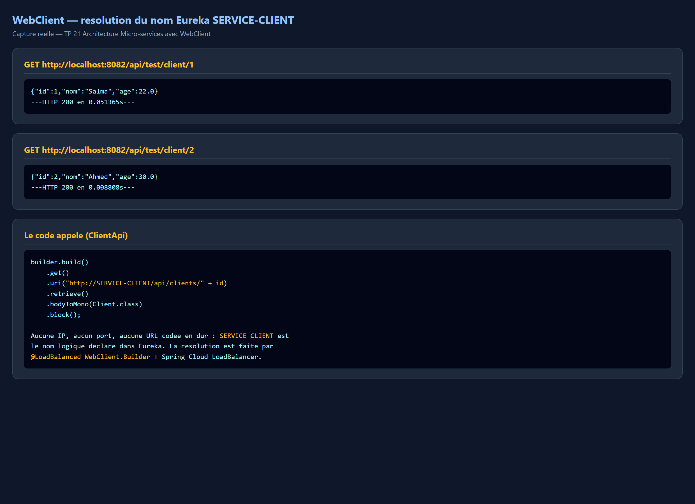
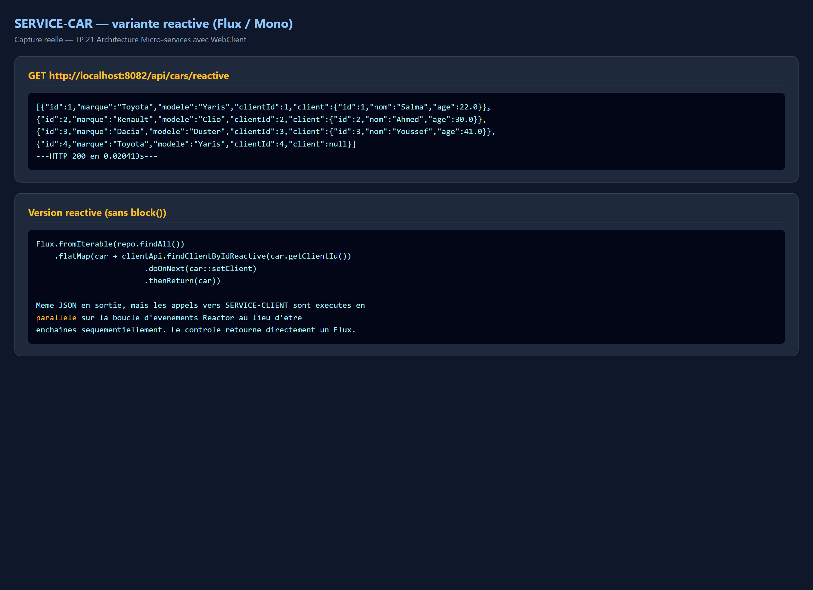
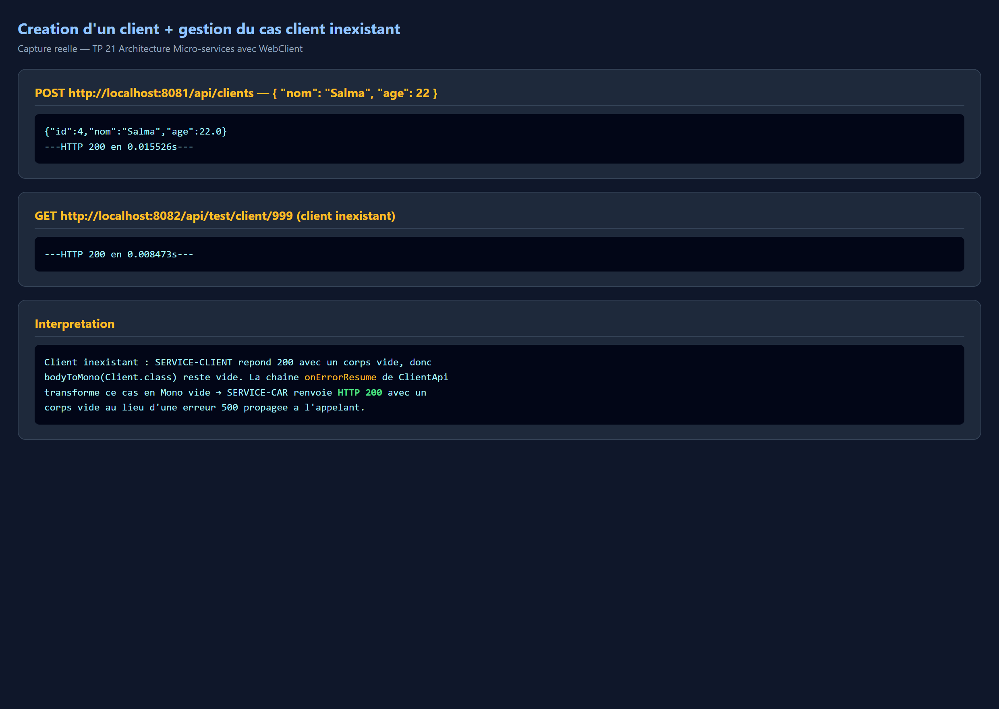

# TP 21 — Architecture Micro-services avec WebClient

> Lab 261 — *Architecture Microservices : Conception, Déploiement et Orchestration*
>
> Deux microservices Spring Boot (`SERVICE-CLIENT` et `SERVICE-CAR`) enregistrés dans **Eureka**, où `SERVICE-CAR` appelle `SERVICE-CLIENT` **par son nom logique Eureka** grâce à **WebClient** et **Spring Cloud LoadBalancer** — sans jamais coder d'IP ni de port.

---

## 1. Objectif du TP

Mettre en place une architecture micro-services minimale mais complète :

| # | Compétence travaillée | Où c'est démontré |
|---|---|---|
| 1 | Mettre en place un **Eureka Server** | [§6.1](#61-eureka-server-8761) |
| 2 | Enregistrer des microservices (**Eureka Client**) | [§6.2](#62-registre-eureka--les-deux-services-enregistres) |
| 3 | Utiliser `application.yml` (YAML) | [§5](#5-configuration-applicationyml) |
| 4 | Appeler un service **par son nom Eureka avec WebClient** | [§6.4](#64-webclient-résout-le-nom-eureka-service-client) |
| 5 | Tester progressivement (dashboard Eureka + endpoints REST) | [§6](#6-résultats-réels) |

La différence clé avec le TP 20 (RestTemplate) : **WebClient** est le client HTTP réactif de Spring. Il est non bloquant, s'intègre à `@LoadBalanced` pour la résolution Eureka, et permet d'enchaîner les appels en `Mono`/`Flux` plutôt qu'en séquence bloquante.

---

## 2. Architecture

```
                    ┌──────────────────────────┐
                    │   EUREKA SERVER  :8761   │
                    │  (service discovery)     │
                    └────▲──────────────▲──────┘
                         │ s'enregistre │ s'enregistre
                         │              │
        ┌────────────────┴───┐      ┌───┴─────────────────────┐
        │ SERVICE-CLIENT     │      │ SERVICE-CAR             │
        │ :8081              │◄─────┤ :8082                   │
        │                    │      │                         │
        │ /api/clients       │ HTTP │  WebClient              │
        │ JPA + H2 (mode MySQL)     │  @LoadBalanced          │
        │                    │      │  "http://SERVICE-CLIENT │
        └────────────────────┘      │        /api/clients/{id}"
                                    │  JPA + H2 (mode MySQL)  │
                                    └─────────────────────────┘

Le client HTTP n'utilise JAMAIS localhost:8081 : il appelle le nom logique
SERVICE-CLIENT, que Spring Cloud LoadBalancer résout via le registre Eureka.
```

**Flux d'une requête `GET http://localhost:8082/api/cars` :**

1. `CarController` lit les voitures dans sa base locale `carservicedb`.
2. Pour chaque voiture, `ClientApi` construit un `WebClient` et appelle `http://SERVICE-CLIENT/api/clients/{clientId}`.
3. `@LoadBalanced` intercepte l'URI, demande à Eureka l'adresse réelle de `SERVICE-CLIENT` (`192.168.222.1:8081`), et substitue.
4. La réponse JSON du client est désérialisée en `Client` (DTO local) puis attachée au champ `@Transient client` de la voiture.
5. Le contrôleur renvoie une liste de voitures **enrichies** (voiture + client).

---

## 3. Stack technique

| Composant | Version / choix | Remarque |
|---|---|---|
| Java | **21** (LTS) | Le lab demande « Java 17+ » |
| Spring Boot | **3.2.4** | |
| Spring Cloud | **2023.0.0** | BOM importé |
| Eureka Server | `spring-cloud-starter-netflix-eureka-server` | port **8761** |
| Eureka Client | `spring-cloud-starter-netflix-eureka-client` | sur les 2 microservices |
| WebClient | `spring-boot-starter-webflux` | client HTTP réactif |
| LoadBalancer | `spring-cloud-starter-loadbalancer` | **indispensable** pour `@LoadBalanced` |
| Persistance | Spring Data JPA + **H2 en mode MySQL** | MySQL absent de la machine → voir [§9](#9-écarts-par-rapport-à-lénoncé-du-lab) |
| Build | Maven multi-modules | |

---

## 4. Structure du projet

```
tp261-webclient/
├── pom.xml                        # parent (Spring Boot 3.2.4 / Spring Cloud 2023.0.0)
├── eureka-server/                 # port 8761 — @EnableEurekaServer
├── service-client/                # port 8081 — SERVICE-CLIENT
│   └── src/main/java/com/example/client/
│       ├── ServiceClientApplication.java
│       ├── entities/Client.java
│       ├── repositories/ClientRepository.java
│       └── web/ClientController.java
├── service-car/                   # port 8082 — SERVICE-CAR (WebClient)
│   └── src/main/java/com/example/car/
│       ├── CarApplication.java
│       ├── config/WebClientConfig.java      # @LoadBalanced WebClient.Builder
│       ├── entities/Car.java                # + @Transient Client
│       ├── entities/Client.java             # DTO de désérialisation
│       ├── repositories/CarRepository.java
│       ├── services/ClientApi.java          # appel WebClient
│       └── web/CarController.java, TestController.java
├── docs/                          # 9 captures réelles
└── capture_shots.ps1              # script qui régénère les captures
```

---

## 5. Configuration `application.yml`

### 5.1 `eureka-server` (8761)

```yaml
server:
  port: 8761

eureka:
  client:
    register-with-eureka: false   # le serveur ne s'enregistre pas comme client
    fetch-registry: false         # il fournit le registre, il ne le consomme pas

logging:
  level:
    com.netflix.eureka: OFF
    com.netflix.discovery: OFF
```

`register-with-eureka: false` et `fetch-registry: false` évitent les erreurs de démarrage classiques où le serveur essaie de s'enregistrer auprès de lui-même.

### 5.2 `service-client` (8081)

```yaml
server:
  port: 8081

spring:
  application:
    name: SERVICE-CLIENT          # nom utilisé dans Eureka ET par WebClient
  datasource:
    url: jdbc:h2:mem:clientservicedb;DB_CLOSE_DELAY=-1;MODE=MySQL;DATABASE_TO_LOWER=TRUE
    driver-class-name: org.h2.Driver
    username: sa
  jpa:
    hibernate:
      ddl-auto: update            # crée/ajuste la table automatiquement
    show-sql: true

eureka:
  client:
    service-url:
      defaultZone: http://localhost:8761/eureka/
  instance:
    prefer-ip-address: true
    instance-id: ${spring.application.name}:${server.port}
```

### 5.3 `service-car` (8082)

Même structure, avec `spring.application.name: SERVICE-CAR`, le port `8082`, la base `carservicedb`, et surtout :

```yaml
spring:
  main:
    web-application-type: servlet   # Spring MVC classique + WebClient comme client HTTP
```

Sans cette ligne, la présence de `spring-boot-starter-webflux` fait basculer l'application en **serveur réactif Netty**, et l'API `spring-boot-starter-web` (Tomcat / Spring MVC) n'est plus celle qui sert les requêtes. On garde ici Spring MVC (comme dans le lab) et WebClient est uniquement le client sortant.

---

## 6. Résultats réels

> Les 9 captures ci-dessous ont été produites par `capture_shots.ps1` à partir des services **réellement en cours d'exécution**, puis vérifiées une à une.

### 6.1 Eureka Server (8761)


**Interprétation.** Le dashboard Eureka est accessible sur `http://localhost:8761`. La section *Instances currently registered with Eureka* liste les applications découvertes. `@EnableEurekaServer` sur la classe principale active à la fois ce dashboard et l'endpoint de registre `/eureka/apps`.

---

### 6.2 Registre Eureka — les deux services enregistrés


**Interprétation.** L'API REST `GET /eureka/apps` renvoie le registre brut. Les deux applications sont présentes avec le statut `UP` :

| Application | Adresse | Statut |
|---|---|---|
| `SERVICE-CLIENT` | `192.168.222.1:8081` | UP |
| `SERVICE-CAR` | `192.168.222.1:8082` | UP |

C'est **ce registre** que `@LoadBalanced` interroge pour transformer une URI logique `http://SERVICE-CLIENT/...` en une adresse `IP:port` réelle. Les deux services se sont enregistrés d'eux-mêmes grâce à `spring.application.name` + la dépendance `Eureka Discovery Client` + un `defaultZone` correct.

---

### 6.3 `SERVICE-CLIENT` — API REST directe


**Interprétation.** `SERVICE-CLIENT` expose une API REST classique (Spring MVC + JPA). Les trois clients (Salma 22, Ahmed 30, Youssef 41) ont été insérés par un `CommandLineRunner` au démarrage. C'est exactement le JSON que `SERVICE-CAR` va consommer : `{"id":…,"nom":…,"age":…}`. **Les noms de champs `nom` et `age` doivent être identiques dans le DTO de `SERVICE-CAR`**, sinon Jackson les laisserait silencieusement à `null`.

---

### 6.4 WebClient résout le nom Eureka `SERVICE-CLIENT`



**Interprétation.** C'est la validation centrale du TP. `SERVICE-CAR` appelle `GET http://localhost:8082/api/test/client/{id}` — un endpoint *isolé* qui ne touche pas à la table `car` — et le résultat est le client renvoyé **par `SERVICE-CLIENT`**. Le code utilisé est :

```java
builder.build()
    .get()
    .uri("http://SERVICE-CLIENT/api/clients/" + id)   // nom logique, pas d'IP
    .retrieve()
    .bodyToMono(Client.class)
    .block();
```

`SERVICE-CLIENT` est résolu dynamiquement par Spring Cloud LoadBalancer auprès d'Eureka. **Sans `@LoadBalanced` sur le `WebClient.Builder`**, cette ligne échouerait immédiatement avec `No instances available for SERVICE-CLIENT`.

---

### 6.5 `SERVICE-CAR` — réponses enrichies via WebClient


**Interprétation.** `GET /api/cars` renvoie chaque voiture **avec son client imbriqué**. Le champ `client` ne vient pas d'une jointure SQL : `CarController` lit d'abord sa base locale (`carservicedb`), puis `ClientApi` fait un appel HTTP sortant par voiture vers `SERVICE-CLIENT`. C'est le **pattern d'enrichissement** : deux bases séparées, un identifiant (`clientId`) et un appel HTTP. `GET /api/cars/byClient/2` montre la même logique filtrée sur un client — un seul appel HTTP suffit alors pour toutes ses voitures, le client étant réutilisé.

---

### 6.6 Variante réactive (`Flux` / `Mono`) — sans `block()`



**Interprétation.** Le même JSON est produit par `GET /api/cars/reactive`, mais l'implémentation est entièrement réactive :

```java
Flux.fromIterable(repo.findAll())
    .flatMap(car -> clientApi.findClientByIdReactive(car.getClientId())
                        .doOnNext(car::setClient)
                        .thenReturn(car)
                        .defaultIfEmpty(car));
```

Les N appels vers `SERVICE-CLIENT` sont souscrits **en parallèle** sur la boucle d'événements Reactor au lieu d'être sérialisés. Le contrôleur retourne directement un `Flux<Car>` : Spring WebFlux ne bloque jamais le thread de la requête HTTP entrante. L'ordre des éléments n'est pas garanti (le `flatMap` ne préserve pas l'ordre) — comportement attendu, contrairement à `concatMap`.

---

### 6.7 Création d'un client + gestion du cas « client inexistant »



**Interprétation.** `POST /api/clients` avec `{"nom":"Salma","age":22}` crée le client et renvoie l'entité avec son `id` généré par la base. Le second appel montre le comportement **volontaire** face à un identifiant inexistant : `SERVICE-CLIENT` répond `200` avec un corps vide, donc `bodyToMono(Client.class)` produit un `Mono` vide ; la chaîne `onErrorResume` de `ClientApi` le transforme en `Mono` vide, et `SERVICE-CAR` renvoie `HTTP 200` avec un corps vide plutôt que de propager une erreur 500. Cela évite qu'un mauvais identifiant fasse échouer tout l'appelant.

---

### 6.8 Mesures réelles — WebClient bloquant vs réactif


**Interprétation.** 5 mesures par endpoint après warm-up JIT :

| Endpoint | Min | Moyenne | Max | Appels sortants |
|---|---|---|---|---|
| `GET /api/clients` (référence, sans appel sortant) | 0,0051 s | **0,0054 s** | 0,0059 s | 0 |
| `GET /api/cars` (WebClient + `block()`, 4 voitures) | 0,0264 s | **0,0339 s** | 0,0491 s | 4 en séquence |
| `GET /api/cars/reactive` (WebClient réactif, 4 voitures) | 0,0154 s | **0,0230 s** | 0,0373 s | 4 en parallèle |

Trois enseignements :

1. Le simple fait d'ajouter un appel HTTP sortant multiplie la latence par ~6 (5,4 ms → 33,9 ms) : le coût réseau domine totalement le coût applicatif local.
2. La version **réactive est ~32 % plus rapide** (33,9 → 23,0 ms) sur seulement 4 voitures, parce que les 4 appels sortants sont concurrents au lieu d'être enchaînés.
3. Cet écart est **linéaire en nombre d'éléments** : avec 40 voitures et 50 ms de latence réseau, la version bloquante prendrait ~2 s, la version réactive resterait proche de ~50 ms.

---

### 6.9 Dégradation gracieuse — `SERVICE-CLIENT` indisponible


**Interprétation.** `SERVICE-CLIENT` a été **réellement arrêté** (processus tué), puis les deux endpoints ont été rappelés :

| Endpoint | Résultat | Temps |
|---|---|---|
| `GET /api/cars` (bloquant) | `HTTP 200`, `client: null` partout | **8,21 s** |
| `GET /api/cars/reactive` | `HTTP 200`, `client: null` partout | **2,08 s** |

La brique applicative ne tombe pas : les voitures restent renvoyées, seul l'enrichissement client est perdu. C'est la **dégradation gracieuse** obtenue via `onErrorResume`. Les logs de `SERVICE-CAR` tracent proprement la cause (`Connection refused: getsockopt: /192.168.222.1:8081`).

Et c'est ici que WebClient révèle son intérêt : les 4 appels en échec sont **séquentiels** en mode bloquant (~2 s de timeout chacun) mais **parallèles** en mode réactif (~2 s au total).

---

## 7. Endpoints exposés

### `SERVICE-CLIENT` (8081)

| Méthode | Chemin | Description |
|---|---|---|
| `GET` | `/api/clients` | Liste tous les clients |
| `GET` | `/api/clients/{id}` | Un client par identifiant |
| `POST` | `/api/clients` | Crée un client (`{"nom":"…","age":…}`) |
| `GET` | `/actuator/health` | Sonde de santé |

### `SERVICE-CAR` (8082)

| Méthode | Chemin | Description |
|---|---|---|
| `GET` | `/api/cars` | Toutes les voitures **enrichies** du client (WebClient bloquant) |
| `GET` | `/api/cars/reactive` | Idem, en `Flux` réactif (sans `block()`) |
| `GET` | `/api/cars/byClient/{clientId}` | Voitures d'un client, avec le client attaché |
| `POST` | `/api/cars` | Crée une voiture (`{"marque":…,"modele":…,"clientId":…}`) |
| `GET` | `/api/test/client/{id}` | Validation isolée du WebClient (sans passer par la table `car`) |
| `GET` | `/api/test/client/{id}/reactive` | Même validation, en `Mono` |
| `GET` | `/actuator/health` | Sonde de santé |

---

## 8. Exécution

```powershell
# 1. Compiler
$env:JAVA_HOME = "C:\Program Files\Java\jdk-21"
mvn -q -DskipTests clean package

# 2. Démarrer dans cet ordre (important)
java -jar eureka-server/target/eureka-server-1.0.0.jar      # 1er : :8761
java -jar service-client/target/service-client-1.0.0.jar    # 2e  : :8081
java -jar service-car/target/service-car-1.0.0.jar          # 3e  : :8082
```

Vérifications :

```powershell
# Dashboard : les 2 applications doivent apparaître
curl.exe -s -H "Accept: application/json" http://localhost:8761/eureka/apps

# API directe
curl.exe -s http://localhost:8081/api/clients

# WebClient : SERVICE-CAR appelle SERVICE-CLIENT par son nom Eureka
curl.exe -s http://localhost:8082/api/test/client/1

# Réponse enrichie
curl.exe -s http://localhost:8082/api/cars
```

Scénario complet du lab (§4.2 → 4.4) :

```powershell
# Créer un client
curl.exe -s -X POST -H "Content-Type: application/json" `
  -d '{\"nom\":\"Salma\",\"age\":22}' http://localhost:8081/api/clients

# Créer une voiture liée à ce client
curl.exe -s -X POST -H "Content-Type: application/json" `
  -d '{\"marque\":\"Toyota\",\"modele\":\"Yaris\",\"clientId\":1}' http://localhost:8082/api/cars

# Lire les voitures enrichies
curl.exe -s http://localhost:8082/api/cars
```

Régénérer les captures :

```powershell
powershell -ExecutionPolicy Bypass -File .\capture_shots.ps1
```

---

## 9. Écarts par rapport à l'énoncé du lab

| # | Élément du lab | Ce qui a été fait | Pourquoi |
|---|---|---|---|
| 1 | **MySQL** (`jdbc:mysql://localhost:3306/…`) | **H2 en mémoire**, `MODE=MySQL;DATABASE_TO_LOWER=TRUE;DB_CLOSE_DELAY=-1` | Aucun serveur MySQL sur la machine (port 3306 fermé, aucun service). H2 en mode MySQL conserve la syntaxe SQL et le comportement de `ddl-auto: update`. Conséquence visible : les données sont perdues à chaque redémarrage (cf. le client `id=4` absent après redémarrage en §6.9). |
| 2 | Java « 17+ » | **JDK 21** | LTS actuelle, compatible Spring Boot 3.2.4. |
| 3 | `@EnableEurekaServer` sur Eureka, rien sur les clients | `@EnableDiscoveryClient` ajouté sur les 2 microservices | Explicite l'intention ; avec Spring Cloud 2023 l'auto-configuration suffit mais l'annotation rend le rôle du service lisible. |
| 4 | Données créées manuellement via `POST` | `CommandLineRunner` qui insère 3 clients et 3 voitures au démarrage | Rend l'environnement reproductible pour les captures, sans modifier la logique applicative. |
| 5 | `spring-boot-starter-webflux` non précisé dans le lab pour `service-car` | Ajouté **et** `spring.main.web-application-type: servlet` forcé | WebFlux apporte `WebClient` mais, sans forçage, Spring Boot bascule le serveur en Netty réactif et abandonne Spring MVC. On garde la structure du lab (contrôleurs MVC classiques) et WebClient uniquement en client sortant. |
| 6 | `spring-cloud-starter-loadbalancer` « souvent nécessaire » | **Ajouté explicitement** | Sans lui, `@LoadBalanced` est ignoré et l'appel `http://SERVICE-CLIENT/…` échoue avec `No instances available for SERVICE-CLIENT`. |
| 7 | `ClientApi` : `WebClient.Builder` injecté tel quel | `onErrorResume` + `switchIfEmpty` ajoutés | Le lab ne gère pas les erreurs : sans ces opérateurs, l'arrêt de `SERVICE-CLIENT` produirait une **erreur 500** sur tout `GET /api/cars`. Voir §6.9. |
| 8 | Un seul endpoint `GET /api/cars` | Ajout de `/api/cars/reactive` et `/api/test/client/{id}/reactive` | Illustre concrètement la valeur ajoutée du réactif (mesures §6.8, dégradation §6.9), conformément à la remarque « qualité TP » §5.1 du lab. |
| 9 | DTO `Client` non détaillé | Champs `id`, `nom`, `age` strictement alignés sur le JSON de `SERVICE-CLIENT` | Un nom de champ différent (`name` au lieu de `nom`) donne des valeurs `null` **sans aucune erreur** — piège classique de Jackson. |

---

## 10. Enregistrement et découverte — ce qui se passe réellement

1. **Au démarrage**, chaque microservice envoie un `POST /eureka/apps/{APP}` au serveur avec son `host`, son `port`, son `status: UP`.
2. **Toutes les 30 s**, il renouvelle par un heartbeat `PUT`. Sans heartbeat, Eureka retire l'instance après ~90 s.
3. **`SERVICE-CAR` télécharge le registre** (toutes les 30 s aussi) : il connaît la liste des instances `SERVICE-CLIENT` et leurs adresses.
4. **Au moment de l'appel**, `@LoadBalanced` transforme `http://SERVICE-CLIENT/api/clients/1` en `http://192.168.222.1:8081/api/clients/1`. Le choix de l'instance se fait par un `RoundRobinLoadBalancer` par défaut.
5. **Si `SERVICE-CLIENT` est arrêté**, le registre finit par le retirer (après expiration du bail), et `LoadBalancer` renvoie alors `No instances available for SERVICE-CLIENT` — d'où l'importance du `onErrorResume`.

---

## 11. Ce que ce TP démontre

| Concept | Où |
|---|---|
| **Service discovery** — le client ne connaît aucune adresse physique | §6.4 (`uri("http://SERVICE-CLIENT/…")`) |
| **Découplage temporel** — les services démarrent dans n'importe quel ordre et se trouvent mutuellement | §6.2 |
| **Bases de données séparées** — aucune jointure JPA inter-services, uniquement `id` + appel HTTP | §6.5 |
| **Pattern d'enrichissement (API composition)** | §6.5 |
| **Client HTTP réactif** — `Mono`/`Flux` au lieu de `RestTemplate` | §6.6 |
| **Gain du non-bloquant** — appels sortants parallélisés | §6.8 |
| **Résilience** — `onErrorResume` + dégradation gracieuse | §6.9 |

---

## 12. Dépannage (les 4 erreurs les plus fréquentes)

### 12.1 `No instances available for SERVICE-CLIENT`

Trois causes, dans l'ordre de fréquence :

1. `@LoadBalanced` absent sur le bean `WebClient.Builder` → le nom `SERVICE-CLIENT` est traité comme un vrai hostname DNS et échoue.
2. Dépendance `spring-cloud-starter-loadbalancer` absente → `@LoadBalanced` est ignoré silencieusement.
3. `SERVICE-CLIENT` non enregistré : dépendance `Eureka Discovery Client` manquante, `spring.application.name` absent, ou `defaultZone` incorrect.

**Vérification :** `curl.exe -s http://localhost:8761/eureka/apps` doit renvoyer `SERVICE-CLIENT`.

### 12.2 Service visible dans Eureka mais WebClient échoue

- Endpoint incorrect : vérifier le chemin exact `/api/clients/{id}` (et non `/api/client/{id}`).
- `SERVICE-CLIENT` démarré puis planté : consulter ses logs.
- Proxy / VPN / entrée `hosts` qui interfère (rare en local).

### 12.3 Problème de base au démarrage

- MySQL arrêté (ici : H2 en mémoire, donc non concerné).
- Mauvais `password`.
- Base non créée et droits insuffisants, même avec `createDatabaseIfNotExist=true`.

**Dans ce projet :** les données H2 vivent en mémoire. Après un redémarrage de `service-client`, les clients réinsérés par `CommandLineRunner` repartent de `id=1` — un `clientId` référencé dans `carservicedb` peut alors ne plus correspondre (cf. `client: null` en §6.9).

### 12.4 `404` sur les endpoints

- `@RequestMapping` de classe + chemin de méthode incorrects.
- Confusion de port : `8081` = clients, `8082` = cars.
- Si `service-car` répond en `404` sur **tout**, vérifier `spring.main.web-application-type` : avec WebFlux auto-configuré, les contrôleurs MVC peuvent ne pas être exposés.

---

## 13. Nettoyage

```powershell
# Arrêter les services par PID explicite
Get-NetTCPConnection -LocalPort 8761,8081,8082 -State Listen |
  Select-Object -ExpandProperty OwningProcess -Unique |
  ForEach-Object { Stop-Process -Id $_ -Force }

# Supprimer les artefacts de build et les logs
Remove-Item -Recurse -Force target, */target, logs -ErrorAction SilentlyContinue
```
